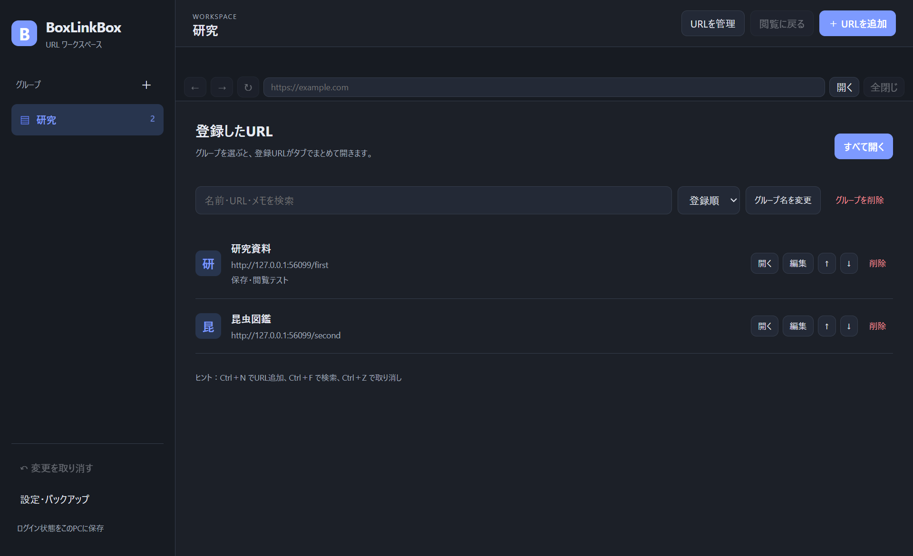

# BoxLinkBox

Windows向けの、グループで整理できるアプリ内ブラウザ。Rust / Wry / Microsoft Edge WebView2で作っています。MITライセンスのオープンソース版です。



## 機能
- グループにURL・名前・メモを登録し、まとめてタブで開く
- アプリ内での閲覧、戻る・進む・再読み込み、URL移動
- 名前・URL・メモの検索、並べ替え、変更の取り消し
- ライト／ダーク／Windows連動テーマ
- JSONバックアップの書き出しと復元
- 専用WebView2プロファイルでログイン状態を保持

初回は空のグループ一覧から始まります。最大40タブ、200グループ、1グループ500URLです。ログイン状態はCookieなどで保持します。独立したパスワード管理機能やクラウド同期はありません。一部の認証やポップアップ方式は対応できない場合があります。

## Windows版を使う
GitHub ReleasesのWindows x64 ZIPを展開し、BoxLinkBox.exeを起動します。Windows 10/11 x64とMicrosoft Edge WebView2 Evergreen Runtimeが必要です。Runtimeがない場合は起動時に公式配布ページを案内します。本体にRuntimeは含めません。この配布EXEはコード署名されていません。

通常の保存先は `%LOCALAPPDATA%\BoxLinkBox\data`。実際の使用パスは設定画面で確認できます。登録データに独自の暗号化はありません。削除・バックアップの取扱いは[プライバシーポリシー](PRIVACY.md)を参照してください。

## LinkNestとの関係
Store版LinkNestを元にした別アプリです。Store版の製品識別子、ライセンス認証、パッケージは含めません。保存先とブラウザプロファイルは独立しています。LinkNestからグループを移行する場合は、JSONを書き出してBoxLinkBoxで復元してください。Cookieやログイン情報は移行しません。

## ビルド
必要なもの：Rust 1.96以降（stable MSVC）、Visual Studio 2022 Build ToolsのC++デスクトップ開発、Windows SDK。Node.jsはGUIテストを行う場合だけ必要です。

```powershell
cargo fetch --locked
.\build.ps1 -Task all
.\target\release\boxlinkbox.exe
```

build.ps1はMSVC環境を初期化し、整形確認・Clippy・テスト・Releaseビルドを行います。依存バージョンはCargo.lockで固定しています。先にfetchを行ったあとはオフラインでビルドします。

GUIテストは専用データとローカルHTTPサーバーを使用します。
```powershell
npm install --no-save playwright
$env:BOXLINKBOX_TEST_ROOT = Join-Path $PWD 'work'
node tests/gui-smoke.cjs
```

開発時だけ `BOXLINKBOX_DATA_DIR` で保存先を指定できます。実際のユーザーデータをテストに使わないでください。

## ライセンス
独自ソースと独自素材は[MIT License](LICENSE)。著作権・許諾表示を保持して改変、再配布、商用利用できます。第三者コードは各ライセンスに従います。[THIRD-PARTY-NOTICES.txt](THIRD-PARTY-NOTICES.txt)と[RUST-STDLIB-NOTICES.txt](RUST-STDLIB-NOTICES.txt)を保持してください。Microsoft WebView2 RuntimeはMicrosoftの別の条件に従います。ソフトウェアと素材のMITライセンスはMicrosoftや第三者の商標権を許諾するものではありません。

改善提案と通常の不具合はGitHub Issuesへ。機密情報やCookie、プロファイル、パスワードを公開投稿しないでください。
